# PHẦN 1: VECTOR & VECTOR DATABASE

## 1.1 Vector là gì? Vai trò của Vector trong AI/ML

### Định nghĩa toán học
Trong toán học tuyến tính, một **Vector** là một phần tử thuộc không gian vector, được biểu diễn dưới dạng một danh sách có thứ tự gồm $d$ phần tử số thực:

$$\mathbf{v} = [v_1, v_2, v_3, \dots, v_d] \in \mathbb{R}^d$$

Ở đây, $d$ được gọi là số chiều (dimensions) của vector. 
- Trong không gian 2D , vector biểu diễn một điểm hoặc hướng mũi tên trên mặt phẳng tọa độ $(x, y)$.
- Trong không gian 3D , vector biểu diễn tọa độ trong không gian vật lý $(x, y, z)$.
- Trong AI/ML hiện đại, vector thường có từ vài trăm đến vài nghìn chiều 

### Vector được sử dụng như thế nào trong AI/ML?
Vector trong AI/ML là một danh sách các con số thực được sắp xếp theo thứ tự cố định, đại diện cho tọa độ hoặc các đặc trưng của một đối tượng trong không gian nhiều chiều

Trong AI/ML, vector đóng vai trò là đơn vị biểu diễn và tính toán :

Mã hóa dữ liệu đầu vào (Feature Representation): Chuyển đổi mọi loại dữ liệu thế giới thực (văn bản, điểm ảnh, sóng âm, hành vi người dùng) thành các mảng số thực (Embeddings) để máy tính có thể đọc và xử lý.

Tính toán và lưu trữ tri thức bên trong mô hình: Toàn bộ trọng số (weights) và trạng thái ẩn (hidden states) của mạng nơ-ron đều là các vector/ma trận. Quá trình AI học và suy luận thực chất là chuỗi các phép nhân cộng tuyến tính giữa vector đầu vào và vector trọng số.

Đo lường độ tương đồng và tìm kiếm (Similarity Search): Bằng cách quy bài toán so sánh ý nghĩa về tính khoảng cách hình học giữa các vector, AI thực hiện được các tác vụ như tìm kiếm ngữ nghĩa (Semantic Search / RAG), hệ thống gợi ý (Recommendation), nhận diện khuôn mặt và phân cụm dữ liệu.

## 1.2 Embedding là gì? Quá trình chuyển đổi dữ liệu thành vector

### Khái niệm Embedding
**Embedding**  là kỹ thuật chuyển đổi dữ liệu (văn bản, hình ảnh, âm thanh) thành các dãy số (vector) trong không gian nhiều chiều sao cho những đối tượng có ý nghĩa giống nhau sẽ nằm gần nhau.

### Quá trình chuyển đổi dữ liệu thành Vector 
Quá trình một đoạn văn bản chuyển thành vector diễn ra qua 4 bước cơ bản:

1. **Tokenization:**
   Văn bản được tách thành chuỗi các token (từ con hoặc ký tự).
   *Ví dụ:* `"Trí tuệ nhân tạo"` $\to$ `[Token_1: "Trí", Token_2: "tuệ", Token_3: "nhân", Token_4: "tạo"]`.
   Mỗi token được gán một số nguyên (Token ID) dựa trên từ điển của mô hình.

2. **Ánh xạ Token ban đầu (Input Embedding + Positional Encoding):**
   Mỗi Token ID được tra cứu qua bảng Embedding Lookup để lấy ra vector ban đầu, sau đó cộng thêm Vector vị trí (Positional Encoding) để mô hình biết thứ tự xuất hiện của từ trong câu.

3. **Chuyển dịch ngữ cảnh qua Transformer Layers (Self-Attention):**
   Mạng Transformer sử dụng cơ chế Multi-Head Attention để cho phép mỗi từ "giao tiếp" và hấp thu ngữ cảnh từ tất cả các từ xung quanh. 

4. **Pooling (Trộn thành một Vector duy nhất):**
   Sau khi đi qua các tầng Transformer, mô hình cho ra một ma trận các vector ứng với từng token. Để đại diện cho cả câu/đoạn văn, cơ chế Pooling được áp dụng:
   - **CLS Token Pooling:** Lấy vector của token đặc biệt `[CLS]` ở đầu câu.
   - **Mean Pooling:** Lấy trung bình cộng vector của tất cả các token trong đoạn.
   - Vector cuối cùng thường được chuẩn hóa (L2 Normalization) về độ dài đơn vị: $\|\mathbf{v}\|_2 = 1$.

---

## 1.3 Vector Database là gì? Khác biệt với Database truyền thống

### Vector Database là gì?
**Vector Database** là cơ sở dữ liệu chuyên dụng để lưu trữ, lập chỉ mục (indexing) và tìm kiếm các vector embedding (mảng số nhiều chiều biểu diễn ý nghĩa hoặc đặc trưng của văn bản, hình ảnh, âm thanh) theo độ tương đồng.

#### Cách hoạt động cốt lõi:
- **Biểu diễn ngữ nghĩa:** Mô hình AI (Embedding Model) chuyển đổi dữ liệu thô (văn bản, ảnh, âm thanh) thành các vector trong không gian nhiều chiều.
- **Khoảng cách tương đồng:** Dữ liệu có ý nghĩa hoặc đặc điểm càng giống nhau thì khoảng cách giữa chúng càng gần nhau trong không gian vector (tính toán thông qua Cosine Similarity, Euclidean Distance, Dot Product,...).
- **Tìm kiếm xấp xỉ nhanh (ANN):** Sử dụng các thuật toán Approximate Nearest Neighbor (như HNSW, IVF, PQ,...) để tìm kiếm nhanh các vector gần nhất trên tập dữ liệu quy mô hàng triệu đến hàng tỷ vector mà không cần quét toàn bộ dữ liệu (brute-force).

Một số Vector Database tiêu biểu: **Pinecone, Milvus, Qdrant, Weaviate, Chroma**, và các extension tích hợp cho CSDL truyền thống như **pgvector (PostgreSQL)**.

---

### Khác biệt giữa Vector Database và Database truyền thống (SQL / NoSQL)

| Tiêu chí | Vector Database | Database truyền thống (SQL / NoSQL) |
| :--- | :--- | :--- |
| **Dữ liệu chính** | Vector đa chiều (kèm metadata) | Bảng (hàng, cột), tài liệu JSON, cặp khóa - giá trị |
| **Cách truy vấn** | Tìm kiếm tương đồng / ngữ nghĩa (Similarity Search) | Khớp chính xác (Exact Match), điều kiện lọc logic, phép nối (JOIN) |
| **Loại dữ liệu mạnh nhất** | Dữ liệu phi cấu trúc (văn bản, hình ảnh, âm thanh, video) | Dữ liệu có cấu trúc hoặc bán cấu trúc rõ ràng |
| **Cơ chế lập chỉ mục (Indexing)** | Các giải thuật ANN (HNSW, IVF, PQ, ScaNN) | B-Tree, Hash Index, Inverted Index |
| **Ứng dụng điển hình** | Tìm kiếm ngữ nghĩa, RAG cho LLM, gợi ý sản phẩm, nhận diện hình ảnh | Giao dịch tài chính (ACID), quản lý đơn hàng, hồ sơ người dùng, ERP/CRM |

---

### Phân biệt cốt lõi: Standalone Vector Index vs Vector Database hoàn chỉnh
*(Theo phân tích chuyên sâu từ Pinecone)*

Nhiều người thường nhầm lẫn giữa một **Vector Index độc lập** (như FAISS của Meta, Annoy của Spotify, ScaNN của Google) và một **Vector Database hoàn chỉnh** (như Pinecone, Milvus, Qdrant). 

Vector Index chỉ là **cấu trúc dữ liệu và thuật toán nằm trong bộ nhớ (in-memory data structure)**, trong khi Vector Database là một **hệ thống quản trị cơ sở dữ liệu cấp doanh nghiệp (Enterprise DBMS)** hoàn chỉnh bao bọc lấy Vector Index:

| Tính năng cốt lõi | Standalone Vector Index (FAISS, Annoy, ScaNN) | Vector Database hoàn chỉnh (Pinecone, Qdrant, Milvus) |
| :--- | :--- | :--- |
| **Bản chất kỹ thuật** | Thư viện giải thuật / Data Structure thuần túy trong RAM | Hệ quản trị cơ sở dữ liệu phân tán (Distributed DBMS) hoàn chỉnh |
| **Khả năng CRUD** | Rất hạn chế; thường chỉ hỗ trợ nạp hàng loạt (bulk load). Muốn thêm/sửa/xóa thường phải build lại index từ đầu rất tốn kém | Hỗ trợ đầy đủ các thao tác CRUD thời gian thực (`Upsert`, `Delete`, `Fetch`, `Update`) mà không cần dừng hệ thống |
| **Metadata Filtering** | Không có hoặc cực kỳ thô sơ; bạn phải tự viết code bên ngoài để map vector ID với dữ liệu gốc | Lưu trữ metadata dạng JSON/Key-Value gắn chặt với vector; hỗ trợ truy vấn lọc logic phức tạp (`$and`, `$in`, `$gte`) |
| **Khả năng mở rộng (Scalability)** | Phải tự cấu hình cụm, tự chia shard, tự quản lý node trên Kubernetes rất phức tạp | Hỗ trợ mở rộng ngang (Horizontal Scaling), tự động sharding, cơ chế Serverless tự động co giãn tài nguyên |
| **Độ bền vững & Sao lưu (Durability & Backup)** | Dữ liệu chỉ nằm trên RAM hoặc file dump cục bộ; nếu crash tiến trình sẽ mất dữ liệu chưa lưu | Tự động ghi nhật ký WAL (Write-Ahead Logging), snapshot định kỳ, tính năng sao lưu theo **Collections** độc lập |
| **Bảo mật & Multitenancy** | Không có hệ thống phân quyền hoặc bảo mật tích hợp sẵn | Hỗ trợ xác thực API Key, mã hóa dữ liệu at-rest & in-transit, phân vùng cô lập người dùng qua **Namespaces** |
| **Tích hợp hệ sinh thái** | Lập trình viên phải tự viết pipeline tích hợp thủ công | Tích hợp sẵn với hệ sinh thái AI hiện đại: LangChain, LlamaIndex, Spark, Kafka, Databricks, OpenTelemetry |

---

### Quy trình hoạt động của một Vector Database Pipeline
Kiến trúc tiêu chuẩn của một Vector Database được tổ chức thành một chuỗi đường ống 3 giai đoạn (Pipeline):

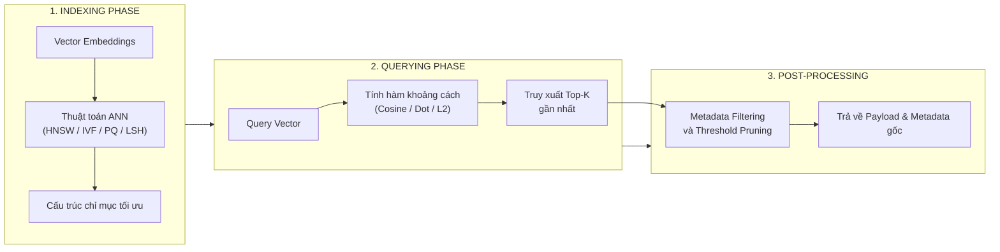

1. **Giai đoạn Lập chỉ mục (Indexing):** Vector Database sử dụng các thuật toán ANN (như HNSW, IVF, PQ, LSH, Random Projection) để ánh xạ các vector vào các cấu trúc dữ liệu tối ưu hóa cho việc duyệt nhanh (đồ thị, bảng băm, cây hoặc phân cụm).
2. **Giai đoạn Truy vấn (Querying):** Khi nhận query vector, hệ thống tính toán khoảng cách tương đồng giữa query vector và các vector được lập chỉ mục để tìm ra các láng giềng gần nhất (Nearest Neighbors).
3. **Giai đoạn Hậu xử lý (Post-processing):** Hệ thống tiến hành lọc bỏ các kết quả không thỏa mãn điều kiện metadata (Metadata Filtering), cắt bỏ các kết quả có điểm tương đồng dưới ngưỡng (Similarity Threshold Cutoff), tái sắp xếp (Reranking) và lấy ra payload nội dung gốc tương ứng với các vector đó.

---

### Kiến trúc Serverless Vector Database (Decoupled Compute & Storage)
Thế hệ Vector Database hiện đại (tiêu biểu như Pinecone Serverless) đã chuyển dịch sang kiến trúc **tách rời hoàn toàn giữa Lưu trữ (Storage) và Tính toán (Compute)**:

- **Lưu trữ Blob giá rẻ (Object Storage):** Toàn bộ dữ liệu vector và index được lưu trữ lâu dài trên các dịch vụ lưu trữ đám mây như AWS S3 hoặc Google Cloud Storage, giúp chi phí lưu trữ giảm tới 90% so với việc găm toàn bộ dữ liệu trên RAM máy chủ đắt đỏ.
- **Tính toán vô trạng thái (Stateless Compute Workers):** Các node xử lý truy vấn có thể tự động co giãn (scale-out) khi có lượng truy vấn cao và co về 0 (scale-to-zero) khi không có người dùng, loại bỏ chi phí máy chủ nhàn rỗi.
- **Phân tầng bộ nhớ đệm (Multi-tier Caching):** Để duy trì tốc độ mili-giây, hệ thống sử dụng SSD NVMe cục bộ và RAM làm bộ nhớ đệm cho các chỉ mục "nóng" (hot indexes), kết hợp giữa chi phí cực thấp của Object Storage và hiệu năng vượt trội của RAM.

---

### So sánh chi tiết Vector Database vs Database truyền thống

| Tiêu chí | Cơ sở dữ liệu truyền thống (RDBMS / NoSQL) | Vector Database |
| :--- | :--- | :--- |
| **Kiểu dữ liệu chính** | Dữ liệu có cấu trúc (bảng, hàng, cột), chuỗi ký tự, số, JSON, key-value | Vector số học nhiều chiều (Dense Vectors: 128 - 3072 dims) kèm metadata |
| **Bản chất phép truy vấn** | **Truy vấn chính xác (Exact Match):** So khớp điều kiện logic tuyệt đối (`WHERE age > 25 AND city = 'Hanoi'`) | **Truy vấn xấp xỉ tương đồng (Similarity Match):** Tìm các điểm dữ liệu gần nhất trong không gian (`Find Top-K nearest to Query Vector`) |
| **Cấu trúc chỉ mục (Index)** | B-Tree, B+Tree, Hash Index, Inverted Index (Lập chỉ mục 1D hoặc phân cấp) | HNSW (Graph), IVF (Clustering), PQ (Quantization), LSH (Hashing), ScaNN |
| **Đặc tính kết quả** | **Xác định (Deterministic):** Cùng một câu lệnh query luôn cho ra tập kết quả chính xác 100% giống nhau | **Xác suất (Probabilistic):** Kết quả mang tính xấp xỉ tốt nhất (Approximate Nearest Neighbors - ANN) với độ hồi tưởng (Recall) cao |
| **Thước đo khoảng cách** | Phép so sánh số học ($=, \neq, <, >$), so khớp xâu ký tự (Regex, LIKE) | Cosine Distance, L2 Euclidean, Dot Product, Manhattan Distance |
| **Trường hợp sử dụng** | Quản lý hóa đơn, ngân hàng, kho hàng, đăng nhập, CRUD ứng dụng | Semantic Search, RAG cho LLM, Nhận diện khuôn mặt/ảnh, Đề xuất sản phẩm (Recommendation System) |

---

## 1.4 Các phép đo độ tương đồng giữa Vector

Khi biểu diễn dữ liệu dưới dạng vector, câu hỏi cốt lõi là: *Làm sao biết hai vector $\mathbf{u}$ và $\mathbf{v}$ giống nhau hay khác nhau bao nhiêu phần trăm?* Có 3 phép đo toán học phổ biến nhất:

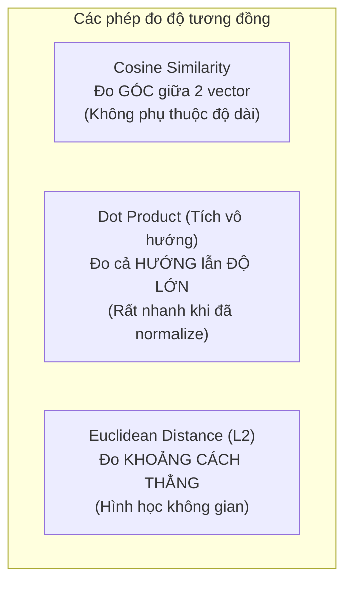

### 1. Cosine Similarity (Độ tương đồng Cosine)
Cosine Similarity đo cosin của góc $\theta$ tạo bởi hai vector trong không gian. Nó chỉ quan tâm đến **hướng (direction)** của vector mà bỏ qua **độ lớn (magnitude)** của chúng.

$$\text{Cosine Similarity}(\mathbf{u}, \mathbf{v}) = \cos(\theta) = \frac{\mathbf{u} \cdot \mathbf{v}}{\|\mathbf{u}\| \|\mathbf{v}\|} = \frac{\sum_{i=1}^d u_i v_i}{\sqrt{\sum_{i=1}^d u_i^2} \sqrt{\sum_{i=1}^d v_i^2}}$$

- **Miền giá trị:** $[-1, 1]$.
  - $+1$: Hai vector hoàn toàn cùng hướng (ngữ nghĩa giống hệt nhau).
  - $0$: Hai vector trực giao (vuông góc - độc lập ngữ nghĩa, không liên quan).
  - $-1$: Hai vector hoàn toàn ngược hướng.
- **Khoảng cách Cosine (Cosine Distance):** $D_{\text{cosine}} = 1 - \text{Cosine Similarity}$, nằm trong đoạn $[0, 2]$.
- **Khi nào dùng?** Cực kỳ lý tưởng cho xử lý văn bản (NLP). Một đoạn văn ngắn và một đoạn văn dài có thể nói về cùng một chủ đề (cùng hướng vector), nhưng đoạn văn dài sẽ có vector với độ lớn lớn hơn. Cosine loại bỏ được sự chênh lệch này.

### 2. Dot Product (Tích vô hướng)
Tích vô hướng tính tổng tích các phần tử tương ứng của hai vector:

$$\mathbf{u} \cdot \mathbf{v} = \sum_{i=1}^d u_i v_i = \|\mathbf{u}\| \|\mathbf{v}\| \cos(\theta)$$

- **Miền giá trị:** $(-\infty, +\infty)$.
- **Điểm đặc biệt:** Nếu hai vector đã được **chuẩn hóa độ dài đơn vị (L2 Normalized)**, tức là $\|\mathbf{u}\| = 1$ và $\|\mathbf{v}\| = 1$, thì:
  $$\mathbf{u} \cdot \mathbf{v} = 1 \times 1 \times \cos(\theta) = \text{Cosine Similarity}$$
- **Khi nào dùng?** Hầu hết các dịch vụ nhúng (như OpenAI `text-embedding-3`, Cohere) đều chuẩn hóa sẵn vector đầu ra. Khi vector đã chuẩn hóa, tính Dot Product nhanh hơn Cosine Similarity rất nhiều vì bỏ qua được phép chia căn bậc hai tốn kém tài nguyên CPU/GPU.

### 3. Euclidean Distance ($L_2$ Distance - Khoảng cách Euclid)
Khoảng cách Euclid đo độ dài đoạn thẳng nối giữa hai điểm đầu mút của vector:

$$d(\mathbf{u}, \mathbf{v}) = \|\mathbf{u} - \mathbf{v}\|_2 = \sqrt{\sum_{i=1}^d (u_i - v_i)^2}$$

- **Miền giá trị:** $[0, +\infty)$.
  - $0$: Hai vector trùng khít nhau.
  - Càng lớn: Hai vector càng xa nhau.
- **Khi nào dùng?** Phổ biến trong thị giác máy tính (computer vision), clustering (K-Means), hoặc các bài toán phân loại hình học nơi độ lớn tuyệt đối của từng đặc trưng (ví dụ: chiều cao, cân nặng, cường độ sáng) mang ý nghĩa vật lý thực sự.

### Ví dụ minh họa tính toán bằng số học
Giả sử ta có 2 vector 3 chiều: $\mathbf{u} = [1, 2, 3]$ và $\mathbf{v} = [2, 4, 5]$:
- **Dot Product:** $\mathbf{u} \cdot \mathbf{v} = (1 \times 2) + (2 \times 4) + (3 \times 5) = 2 + 8 + 15 = 25$.
- **Độ dài (Norm):** $\|\mathbf{u}\| = \sqrt{1^2 + 2^2 + 3^2} = \sqrt{14} \approx 3.742$; $\|\mathbf{v}\| = \sqrt{2^2 + 4^2 + 5^2} = \sqrt{45} \approx 6.708$.
- **Cosine Similarity:** $\frac{25}{3.742 \times 6.708} \approx \frac{25}{25.101} \approx 0.996$ (Góc rất nhỏ, cực kỳ tương đồng về hướng).
- **Euclidean Distance:** $d(\mathbf{u}, \mathbf{v}) = \sqrt{(1-2)^2 + (2-4)^2 + (3-5)^2} = \sqrt{1 + 4 + 4} = \sqrt{9} = 3.0$.

---

# PHẦN 2: VECTOR DATABASE SEARCH ALGORITHMS

## 2.1 Các phương pháp tìm kiếm vector phổ biến

Để tìm kiếm các vector giống nhất với một query vector trong kho dữ liệu, có các họ thuật toán chính:
1. **Linear / Flat Search (Brute Force):** Quét toàn bộ không gian.
2. **Clustering-based Index (IVF):** Gom cụm không gian thành các khoanh vùng tế bào.
3. **Graph-based Index (HNSW, Vamana/DiskANN):** Xây dựng mạng lưới liên kết điểm theo hình thái "thế giới nhỏ" (Small World).
4. **Quantization-based Index (PQ, SQ):** Nén dữ liệu vector số thực để tăng tốc độ tính toán trong RAM/Cache.
5. **Tree-based Index (KD-Tree, Ball-Tree, Annoy):** Phân chia không gian bằng các siêu phẳng (hiệu quả ở số chiều thấp $< 20$, suy giảm nghiêm trọng ở số chiều cao do "lời nguyền số chiều" - Curse of Dimensionality).

---

## 2.2 Exact Search và Approximate Nearest Neighbor (ANN)

### Exact Search (k-Nearest Neighbors - k-NN thuần)
Phương pháp tìm kiếm chính xác (hay còn gọi là Flat Index):
- **Cơ chế:** Lấy query vector so sánh khoảng cách lần lượt với từng vector trong số $N$ vector của cơ sở dữ liệu, sau đó sắp xếp chọn ra $K$ vector gần nhất.
- **Độ phức tạp tính toán:** $O(N \cdot d)$.
- **Ưu điểm:** Độ chính xác (Recall) đạt tuyệt đối 100%. Không làm mất mát thông tin.
- **Nhược điểm:** Khi $N$ đạt từ vài trăm nghìn đến hàng triệu vector, thời gian truy vấn lên tới hàng giây hoặc hàng phút $\implies$ Hoàn toàn bất khả thi cho các ứng dụng thực tế thời gian thực.

### Approximate Nearest Neighbor (ANN)
Trong thực tế, người dùng không cần kết quả phải chính xác tuyệt đối 100% đến từng vị trí thập phân; họ chấp nhận độ chính xác 95% - 99% (nghĩa là có thể trượt 1-2 vector tối ưu nhất) đổi lại thời gian phản hồi chỉ dưới 10 mili-giây.
- **Cơ chế:** Sử dụng các cấu trúc dữ liệu xấp xỉ (đồ thị, phân cụm, băm, nén) để giới hạn phạm vi tìm kiếm xuống một tập con nhỏ các ứng viên tiềm năng.
- **Độ phức tạp:** Giảm từ $O(N)$ xuống $O(\log N)$ hoặc thậm chí $O(1)$.

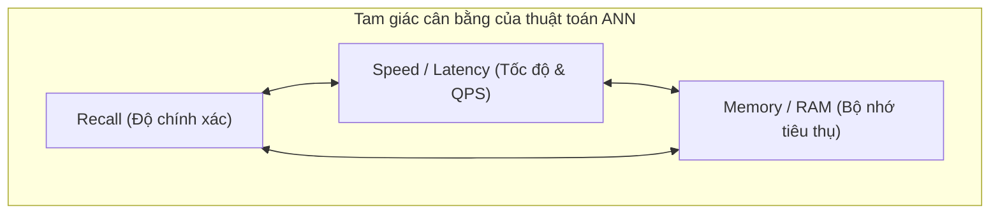

---

## 2.3 Nguyên lý hoạt động cơ bản của HNSW, IVF và PQ

Đây là 3 trụ cột thuật toán quan trọng nhất được sử dụng trong các hệ thống Vector Database hiện đại (Milvus, Pinecone, FAISS, Qdrant).

### 1. HNSW (Hierarchical Navigable Small World)
HNSW là thuật toán dạng đồ thị (Graph-based), hiện là tiêu chuẩn vàng về tốc độ truy vấn và độ chính xác (Recall cao nhất trong các giải pháp ANN in-memory).

#### Ý tưởng cốt lõi:
HNSW kết hợp 2 khái niệm:
- **Navigable Small World (NSW):** Đồ thị mạng xã hội, nơi mọi nút đều có thể kết nối tới các nút khác thông qua một số ít bước nhảy (nguyên lý 6 bậc cách biệt - Six Degrees of Separation).
- **Skip-List (Danh sách liên kết nhảy tầng):** Cấu trúc phân tầng giúp tìm kiếm nhị phân $O(\log N)$ trên danh sách liên kết.

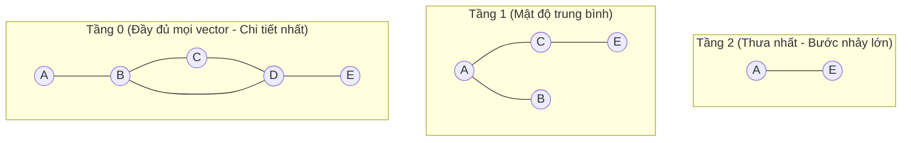

#### Quy trình tìm kiếm:
1. Bắt đầu từ một điểm vào (Entry Point) cố định ở **tầng cao nhất** (tầng thưa nhất).
2. Ở tầng này, các cạnh liên kết là các "bước nhảy dài" (long-range connections). Thuật toán áp dụng tìm kiếm tham lam (Greedy Search): nhảy sang nút láng giềng gần query vector hơn điểm hiện tại cho đến khi gặp cực tiểu cục bộ (local minimum).
3. Chuyển xuống tầng ngay bên dưới tại vị trí nút vừa tìm được.
4. Lặp lại quá trình tìm kiếm tham lam với các bước nhảy ngắn hơn.
5. Khi chạm tới **Tầng 0** (chứa tất cả các vector), thuật toán mở rộng bán kính tìm kiếm để chọn ra đúng $K$ láng giềng gần nhất.

---

### 2. IVF (Inverted File Index)
IVF giải quyết bài toán quy mô bằng cách **chia để trị** không gian đa chiều thông qua phân cụm (Clustering).

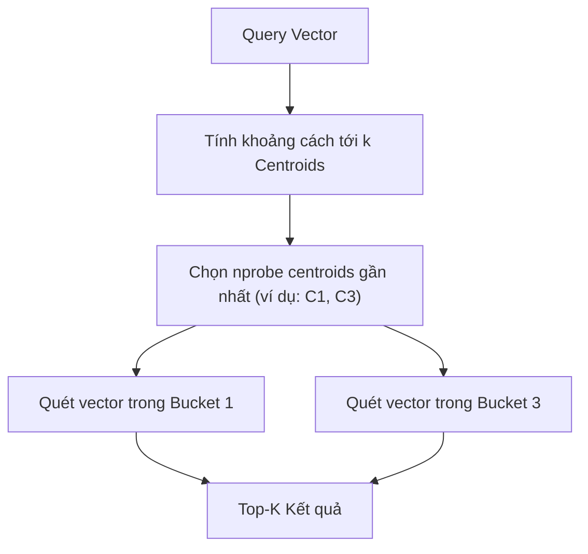

#### Quy trình hoạt động:
1. **Giai đoạn huấn luyện & lập chỉ mục (Offline Indexing):**
   - Áp dụng thuật toán K-Means chia toàn bộ $N$ vector thành $k$ cụm (Voronoi cells). Tâm của mỗi cụm được gọi là một **Centroid**.
   - Tạo một danh sách đảo ngược (Inverted List): Mỗi centroid sở hữu một "bucket" chứa danh sách ID của các vector nằm gần centroid đó nhất.
2. **Giai đoạn tìm kiếm (Online Query):**
   - Nhận một query vector. So sánh nó với $k$ centroids để tìm ra `nprobe` centroids gần nhất (ví dụ chọn 4 centroids trong tổng số 1024 centroids).
   - Chỉ thực hiện tìm kiếm chi tiết bên trong các bucket của `nprobe` centroids này, bỏ qua hoàn toàn $99\%$ dữ liệu còn lại trong DB.

---

### 3. PQ (Product Quantization)
PQ là kỹ thuật **nén dữ liệu có mất mát (lossy compression)** giúp giảm dung lượng RAM tiêu thụ lên tới 95% - 98% và tăng tốc tính toán khoảng cách.

#### Cơ chế hoạt động:
Giả sử vector có $d = 128$ chiều biểu diễn bằng số thực 32-bit (cần $128 \times 4 = 512$ bytes).
1. **Chia nhỏ vector:** Cắt vector 128 chiều thành $m = 8$ sub-vector, mỗi sub-vector có 16 chiều.
2. **Gom cụm độc lập (Clustering từng phân đoạn):**
   - Với mỗi phân đoạn 16 chiều, chạy K-Means tạo ra 256 centroids (mỗi centroid đánh số ID từ $0$ đến $255$, lưu gọn trong 1 byte: $2^8 = 256$).
   - Tập hợp các centroids này gọi là **Codebook**.
3. **Mã hóa (Quantization):**
   - Thay vì lưu 16 số thực cho mỗi phân đoạn, ta chỉ lưu 1 byte chỉ số ID của centroid gần phân đoạn đó nhất.
   - Vector ban đầu từ 512 bytes giờ chỉ còn lại **8 bytes** (8 sub-vectors $\times$ 1 byte). Tỉ lệ nén lên tới $64$ lần!
4. **Tính khoảng cách bất đối xứng (ADC - Asymmetric Distance Computation):**
   - Khi có query vector mới, ta giữ nguyên query vector ở dạng float32 gốc (không nén).
   - Tính trước khoảng cách giữa các phần của query với 256 centroids trong Codebook để tạo bảng tra cứu (Look-up Table).
   - Việc tính khoảng cách tới hàng triệu vector trong DB lúc này chỉ là các phép tra cứu bảng và cộng dồn (Table Lookup & Addition) cực kỳ nhanh.

---

### 4. Random Projection (Phép chiếu ngẫu nhiên)
Random Projection là một phương pháp giảm số chiều dữ liệu đơn giản nhưng có nền tảng toán học vô cùng mạnh mẽ:

- **Bản chất toán học:** Dựa trên **Bổ đề Johnson-Lindenstrauss (JL Lemma)**: Một tập hợp các điểm trong không gian số chiều cao ($d$) có thể được chiếu vào một không gian số chiều thấp hơn nhiều ($k \ll d$) bằng một ma trận chiếu ngẫu nhiên $R \in \mathbb{R}^{d \times k}$ mà khoảng cách tương đối giữa các cặp điểm gần như không thay đổi:
  $$\mathbf{v}_{\text{projected}} = \mathbf{v} \times R$$
- **Ưu điểm:** Không cần huấn luyện ma trận (khác với PCA cần tính ma trận hiệp phương sai tốn kém $O(d^3)$). Tốc độ chiếu cực nhanh.
- **Ứng dụng:** Giảm số chiều sơ bộ cho các vector khổng lồ trước khi đưa vào các thuật toán clustering hoặc indexing phức tạp hơn.

---

### 5. LSH (Locality-Sensitive Hashing)
Khác với các hàm băm mật mã học (như MD5, SHA-256 vốn cố tình khuếch đại sự khác biệt: hai chuỗi chỉ khác nhau 1 ký tự sẽ cho ra 2 mã hash hoàn toàn khác nhau), **LSH** làm điều ngược lại:
- **Nguyên lý cốt lõi:** LSH thiết kế các hàm băm sao cho **các vector càng gần nhau trong không gian thì xác suất va chạm (rơi vào cùng một Hash Bucket) càng cao**.
- **Cơ chế Siêu phẳng ngẫu nhiên (Random Hyperplanes):**
  - Cắt không gian vector bằng một tập hợp các siêu phẳng ngẫu nhiên.
  - Một vector nằm ở phía này của siêu phẳng sẽ được gán bit `1`, nằm ở phía bên kia sẽ nhận bit `0`.
  - Một chuỗi $b$ siêu phẳng sẽ biến mỗi vector thành một chuỗi nhị phân $b$-bit (gọi là Hash Signature).
- **Quy trình tìm kiếm:** Khi có query vector, tính mã hash của query rồi chỉ việc lấy ra tất cả các vector nằm chung bucket đó để so sánh chi tiết. Tốc độ tìm kiếm đạt $O(1)$ hoặc $O(\log N)$.

---

## 2.4 Ưu nhược điểm và trường hợp sử dụng

| Thuật toán | Ưu điểm | Nhược điểm | Trường hợp sử dụng tối ưu |
| :--- | :--- | :--- | :--- |
| **Exact (Flat)** | • Recall tuyệt đối 100% • Không cần thời gian build index • Thêm/sửa/xoá tức thì | • Rất chậm khi $N$ lớn • Không scale được quá $10^5$ vector | Tập dữ liệu nhỏ ($< 50.000$ vectors), môi trường kiểm thử benchmark, dữ liệu lọc metadata ngặt nghèo |
| **HNSW** | • Tốc độ truy vấn siêu nhanh (vài ms) • Recall xuất sắc ($95\% - 99\%$) | • Ngốn RAM rất lớn (phải lưu đồ thị liên kết) • Build index lâu • Xoá nút làm phân mảnh đồ thị | Ứng dụng production thời gian thực đòi hỏi độ chính xác cao và độ trễ thấp (Chatbot RAG, Search Engine lớn) |
| **IVF** | • Build index nhanh hơn HNSW • RAM tiêu thụ ở mức vừa phải • Dễ dàng kiểm soát Recall qua `nprobe` | • Recall thấp hơn HNSW ở cùng latency • Dễ rơi vào biên Voronoi gây bỏ sót điểm lân cận | Tập dữ liệu trung bình đến lớn (vài triệu vectors), tài nguyên máy chủ vừa phải |
| **PQ / IVF-PQ** | • Tiết kiệm RAM vượt trội ($90\% - 97\%$) • Tải được hàng tỷ vector vào bộ nhớ | • Recall giảm đáng kể do nén mất mát • Cần giai đoạn train codebook | Hệ thống cực lớn (trên 100 triệu đến hàng tỷ vector), chấp nhận hy sinh một phần độ chính xác |
| **ScaNN** | • Tối ưu hóa phép tính hướng (Anisotropic Vector Quantization) • Recall cao hơn PQ truyền thống | • Cấu hình phức tạp hơn, do Google phát triển tối ưu riêng cho AVX2/AVX-512 | Tìm kiếm quy mô lớn trên nền tảng đám mây của Google / Tensor processing |
| **Random Projection** | • Giảm chiều nhanh chóng • Không cần huấn luyện ma trận trước | • Có mất mát thông tin khoảng cách (xấp xỉ) • Chỉ là bước tiền xử lý | Giảm tải số chiều sơ bộ cho các không gian vector cực lớn (> 4096 dims) |
| **LSH** | • Tốc độ truy vấn siêu nhanh $O(1)$ • Tiết kiệm bộ nhớ | • Recall thấp hơn HNSW đáng kể • Dễ bỏ sót láng giềng ở sát biên siêu phẳng | Hệ thống tìm kiếm tương đồng trên quy mô dữ liệu khổng lồ với yêu cầu phần cứng tối giản |

---

## 2.5 Cơ chế Metadata Filtering chuyên sâu
*(Một trong những tính năng sống còn của Vector Database do Pinecone tiên phong tối ưu)*

Trong ứng dụng thực tế, người dùng hiếm khi tìm kiếm vector đơn thuần mà luôn kèm theo các điều kiện lọc:
> *"Tìm các văn bản tương đồng với 'hướng dẫn thanh toán', NHƯNG chỉ lấy các tài liệu có `status = 'published'` VÀ `department = 'Finance'` VÀ `year >= 2023`"*.

Có 3 cơ chế xử lý việc lọc metadata này:

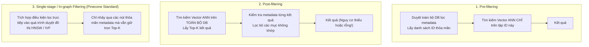

1. **Post-filtering (Lọc sau):**
   - **Cách làm:** Thực hiện tìm kiếm vector trên toàn bộ dữ liệu để lấy ra Top $K$ vector gần nhất. Sau đó mới duyệt qua $K$ vector này để lọc theo điều kiện metadata.
   - **Nhược điểm nghiêm trọng:** Nếu điều kiện metadata quá ngặt nghèo (ví dụ chỉ có 1% tài liệu thuộc phòng Finance), thì trong Top $K$ tìm về có thể không có tài liệu nào thuộc Finance cả $\implies$ Hệ thống trả về **kết quả rỗng** hoặc **chỉ còn 1-2 kết quả**, mặc dù trong DB vẫn còn hàng nghìn tài liệu Finance phù hợp.

2. **Pre-filtering (Lọc trước):**
   - **Cách làm:** Sử dụng chỉ mục scalar truyền thống để lọc ra tập hợp các ID thỏa mãn metadata trước. Sau đó mới thực hiện tìm kiếm vector trên tập ID này.
   - **Nhược điểm:** Phá vỡ cấu trúc chỉ mục ANN. Nếu tập ID lọc ra quá nhỏ, việc áp dụng HNSW graph trên tập con phân tán là bất khả thi (buộc phải quay về quét tuyến tính Brute Force).

3. **Single-stage / In-graph Filtered Search (Lọc đơn kỳ tích hợp):**
   - **Cách làm (Tiêu chuẩn của Pinecone & Qdrant):** Điều kiện lọc metadata được tích hợp trực tiếp vào bước duyệt đồ thị ANN. Khi thuật toán HNSW duyệt từ nút này sang nút khác, nó kiểm tra metadata của nút kế tiếp; nếu không thỏa mãn, nó vẫn có thể đi xuyên qua nút đó để dẫn đường nhưng sẽ không đưa nút đó vào danh sách Top-$K$ ứng viên.
   - **Ưu điểm:** Luôn đảm bảo trả về **đúng và đủ $K$ kết quả chính xác**, đồng thời tận dụng được toàn bộ sức mạnh tốc độ của đồ thị ANN.

---

## 2.6 Vận hành và kiến trúc mở rộng của Vector Database (Operations at Scale)

Khi triển khai Vector Database ở quy mô hàng trăm triệu đến hàng tỷ vector cho các tập đoàn lớn, các khía cạnh vận hành sau là bắt buộc:

1. **Sharding & Scatter-Gather Pattern:**
   - Khi dữ liệu vượt quá dung lượng của một máy chủ, vector index được phân chia thành nhiều mảnh (**shards**) trên nhiều node vật lý.
   - Khi có truy vấn từ client, node điều phối (coordinator) sẽ phân tán câu hỏi tới tất cả các shard (**Scatter**). Mỗi shard tự tìm kiếm Top-$K$ cục bộ của mình rồi gửi về. Node điều phối sẽ hợp nhất các danh sách và chọn ra Top-$K$ toàn cục (**Gather**).
2. **Replication & Mô hình nhất quán (Consistency Models):**
   - Tạo nhiều bản sao (replicas) cho mỗi shard để tăng tải đọc (Read QPS) và đảm bảo tính chịu lỗi (Fault Tolerance) khi một node gặp sự cố phần cứng.
   - **Strong Consistency:** Đảm bảo mọi bản ghi mới cập nhật đều đọc được ngay trên tất cả bản sao, nhưng độ trễ ghi sẽ cao hơn.
   - **Eventual Consistency:** Cho phép các bản sao đồng bộ chậm hơn vài trăm mili-giây để tối ưu hóa độ trễ và khả năng sẵn sàng (Availability).
3. **Namespaces & Multi-tenancy (Phân vùng đa người thuê):**
   - Cho phép một cụm cơ sở dữ liệu phục vụ hàng nghìn khách hàng khác nhau. Mỗi khách hàng sở hữu một **Namespace** riêng biệt. Dữ liệu giữa các namespace được cô lập hoàn toàn về mặt logic, ngăn chặn rò rỉ dữ liệu giữa các tenant mà không tốn chi phí dựng cụm server riêng.
4. **Collections & Backups:**
   - Khả năng tạo snapshot dữ liệu tĩnh tại một thời điểm (như tính năng Collections của Pinecone), cho phép sao lưu, di chuyển index giữa các môi trường (Dev/Staging/Prod) hoặc nhân bản dữ liệu một cách an toàn.

---

# PHẦN 3: AI MEMORY MANAGEMENT

## 3.1 AI Memory là gì? Cách AI quản lý và sử dụng thông tin

### Bản chất Stateless của LLM
Về mặt bản chất kỹ thuật, các mô hình ngôn ngữ lớn (như GPT-4, Gemini, Claude) là **phi trạng thái (Stateless)**:
- Mỗi lượt gọi API (turn) là một tiến trình tính toán độc lập hoàn toàn.
- Mô hình không sở hữu một ổ đĩa hay bộ não vật lý tự lưu lại những gì người dùng đã nói ở câu trước.
- Sở dĩ người dùng có cảm giác "AI đang nhớ" là nhờ tầng ứng dụng (Application Layer / Agent Framework) đóng gói lại toàn bộ các câu thoại trước đó gửi kèm vào input của lượt gọi tiếp theo.

### AI Memory là gì?
**AI Memory (Bộ nhớ AI)** là kiến trúc phần mềm bên ngoài cho phép hệ thống AI:
1. **Ghi nhận (Encode/Store):** Thu thập và lưu lại thông tin tương tác, hành vi, dữ kiện.
2. **Duy trì (Retain):** Tổ chức, nén, tổng hợp thông tin theo thời gian.
3. **Hồi tưởng (Retrieve):** Tìm lại đúng thông tin liên quan nhất khi có ngữ cảnh mới xuất hiện để đưa vào Context Window của LLM.

---

## 3.2 Short-term Memory và Long-term Memory

Tương tự như tâm lý học nhận thức của con người, kiến trúc AI Agent chia bộ nhớ thành 2 phân hệ rõ rệt:

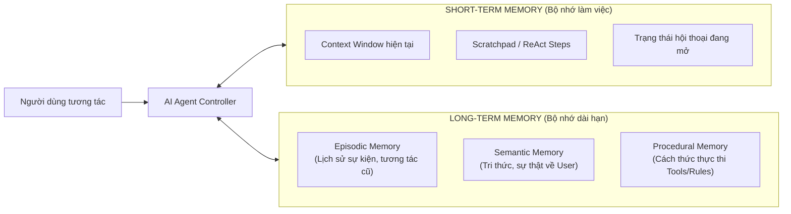

### 1. Short-term Memory (Bộ nhớ ngắn hạn / Working Memory)
- **Đặc điểm:** Tồn tại trong phạm vi một phiên tương tác (session) đang diễn ra.
- **Nơi lưu trữ:** Nằm trực tiếp bên trong **Context Window** hoặc RAM của ứng dụng.
- **Nội dung:** Vài tin nhắn gần nhất, các bước suy luận trung gian (Scratchpad / Chain-of-Thought), kết quả tạm thời vừa gọi từ tool.
- **Đặc tính:** Tốc độ truy xuất ngay tức khắc (zero latency), nhưng sẽ biến mất ngay khi session kết thúc hoặc bị đẩy ra ngoài khi vượt quá giới hạn token.

### 2. Long-term Memory (Bộ nhớ dài hạn)
- **Đặc điểm:** Tồn tại vĩnh viễn (persistent storage) xuyên suốt nhiều tuần, nhiều tháng, qua nhiều phiên trò chuyện khác nhau.
- **Nơi lưu trữ:** Lưu trữ trong cơ sở dữ liệu chuyên biệt: **Vector Database** (để tìm kiếm ngữ nghĩa), **Key-Value Store / SQL** (lưu profile người dùng), hoặc **Knowledge Graph** (lưu mạng lưới thực thể và quan hệ).
- **Phân loại con:**
  - **Episodic Memory (Bộ nhớ biến cố/sự kiện):** Nhớ các sự việc đã diễn ra trong quá khứ ("Hôm qua người dùng bảo họ vừa chuyển công tác sang Đà Nẵng").
  - **Semantic Memory (Bộ nhớ ngữ nghĩa/sự thật):** Nhớ tri thức cô đọng về thế giới hoặc người dùng ("Người dùng là lập trình viên backend", "Dị ứng với đậu phộng").
  - **Procedural Memory (Bộ nhớ thủ tục):** Nhớ cách thức làm việc, quy tắc hành vi ("Khi tạo pull request, luôn viết description bằng tiếng Anh").

---

## 3.3 Context Window, Conversation History và Memory khác nhau như thế nào?

Ba khái niệm này thường bị người mới bắt đầu nhầm lẫn với nhau. Dưới đây là bảng phân định ranh giới rõ ràng:

| Tiêu chí | Context Window | Conversation History | AI Memory |
| :--- | :--- | :--- | :--- |
| **Bản chất** | Giới hạn phần cứng/mô hình (Buffer size tính bằng Token) | Bản ghi thô (Raw Event Logs) của cuộc trò chuyện | Tri thức đã qua tinh lọc, trích xuất và trừu tượng hoá |
| **Vị trí** | Trực tiếp trong Input của Model | Database lưu trữ log (MongoDB, PostgreSQL, Redis) | Vector DB, Knowledge Graph, User Profile JSON |
| **Chi phí** | Đắt đỏ (Mỗi token nạp vào đều tính phí và tăng độ trễ) | Rẻ (Lưu trữ text/JSON thuần trên ổ đĩa) | Vừa phải (Chi phí embedding và indexing) |
| **Cơ chế hoạt động** | Tiếp nhận chuỗi token hiện tại để Transformer tính toán Attention | Ghi nhận tuần tự `role: user`, `role: assistant` không bỏ sót từ nào | Phân tích history $\to$ Trích xuất facts $\to$ Hồi tưởng chọn lọc khi cần |

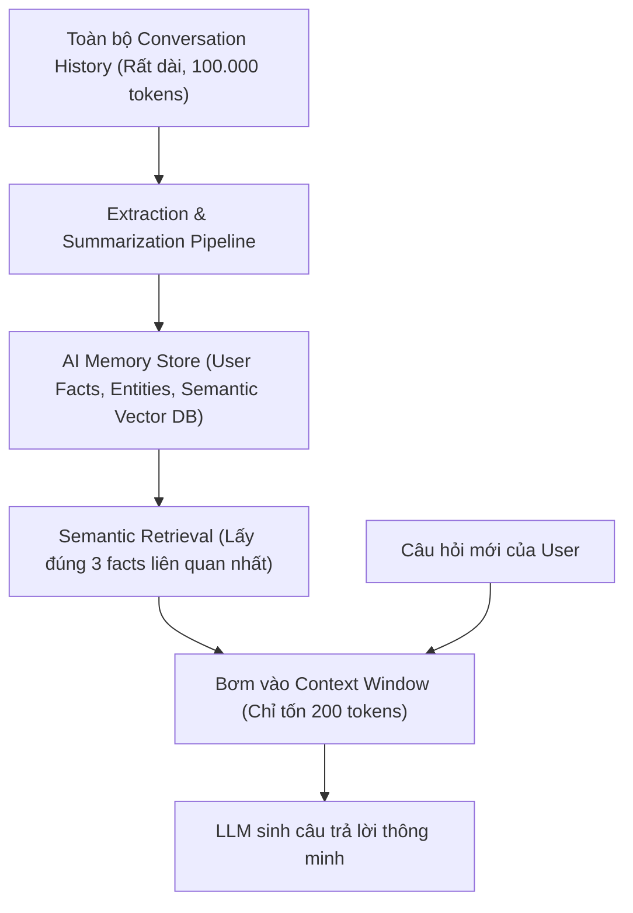

---

## 3.4 Các phương pháp lưu trữ, truy xuất và cập nhật Memory

### 1. Các kỹ thuật quản lý bộ nhớ cơ bản
- **Sliding Window Buffer:** Chỉ giữ lại $k$ lượt thoại gần nhất (ví dụ 10 tin nhắn cuối). Rất đơn giản nhưng sẽ quên sạch các thông tin ở đầu cuộc nói chuyện.
- **Conversation Summary Memory:** Sử dụng một LLM phụ chạy ngầm để tóm tắt các cuộc hội thoại cũ thành một đoạn văn ngắn gọn và liên tục cập nhật đoạn tóm tắt này khi có hội thoại mới.
- **Entity Memory:** Nhận diện các thực thể quan trọng (tên người, dự án, sở thích) và lưu thành cặp `Key-Value` hoặc thuộc tính JSON.

### 2. Kiến trúc phân cấp nâng cao (Hierarchical Memory - MemGPT / Letta)
Mô hình bộ nhớ hiện đại lấy cảm hứng từ hệ điều hành máy tính (OS Virtual Memory):
- **Core Memory (như RAM):** Nằm trực tiếp trong system prompt, gồm 2 khối:
  - `persona`: Định hình nhân cách AI.
  - `human`: Các thông tin cốt lõi về người dùng (tên, sở thích, tính cách). AI có thể tự động gọi hàm `edit_core_memory()` để cập nhật khối này bất cứ lúc nào.
- **Recall Memory (như Cache):** Lưu trữ toàn bộ lịch sử tin nhắn dạng phân trang, có thể tìm kiếm theo từ khóa.
- **Archival Memory (như Ổ cứng / Disk):** Một Vector Database khổng lồ lưu trữ tài liệu sâu, ghi chú dài hạn. Khi cần, AI chủ động gọi hàm `archival_memory_search()` để lấy thông tin vào Core Memory.

### 3. Vòng đời của Memory (The Memory Lifecycle)
1. **Thu nạp (Ingestion):** Lắng nghe cuộc hội thoại giữa user và bot.
2. **Chiêm nghiệm & Cô đọng (Reflection & Extraction):** Sau mỗi phiên, một tiến trình chạy ngầm sẽ đặt câu hỏi: *"Có thông tin gì mới về người dùng cần ghi nhớ không?"*
3. **Hợp nhất (Consolidation):** Cập nhật dữ liệu mới vào dữ liệu cũ. Nếu có thông tin thay đổi (ví dụ: người dùng đổi số điện thoại), hệ thống phải ghi đè hoặc đánh dấu phiên bản.
4. **Quên / Giải phóng (Eviction / Forgetting):** Áp dụng công thức suy giảm theo thời gian (Exponential Decay) tương tự não bộ con người:
   $$\text{Score} = \text{Importance} \times e^{-\lambda \cdot \Delta t} + \text{Relevance}$$
   Những ký ức ít quan trọng và lâu ngày không được nhắc lại sẽ bị giảm điểm hoặc xóa bỏ để tránh làm nhiễu không gian tìm kiếm.

---

# PHẦN 4: CHUNKING STRATEGIES

## 4.1 Chunking là gì? Tại sao cần Chunking?

### Chunking là gì?
**Chunking** là kỹ thuật chia nhỏ một tài liệu lớn (văn bản, PDF, code, sách) thành các đoạn văn bản nhỏ hơn (gọi là các **chunks**), sao cho mỗi chunk giữ được tính toàn vẹn về mặt ngữ nghĩa và độc lập tương đối.

### Tại sao bắt buộc phải Chunking?
Nhiều người nghĩ rằng các LLM hiện nay có Context Window rất lớn (Gemini 1M - 2M tokens) thì không cần chunking nữa. Đây là quan niệm sai lầm vì các lý do sau:

1. **Giới hạn của Embedding Models:** Các mô hình tạo vector embedding (như BERT, text-embedding-3) có giới hạn token đầu vào nghiêm ngặt (thường là 512, 2048 hoặc 8192 tokens). Bạn không thể nhét cả một cuốn sách 100 trang vào để lấy ra 1 vector duy nhất.
2. **Hiện tượng loãng ngữ nghĩa (Embedding Dilution):** Khi bạn nén một văn bản 10.000 từ vào một vector 1536 chiều, các thông tin cụ thể (con số, chi tiết nhỏ) sẽ bị hòa tan và biến mất. Vector đó chỉ còn biểu diễn được chủ đề chung chung, làm giảm nghiêm trọng độ chính xác khi tìm kiếm.
3. **Độ chính xác truy xuất (Retrieval Precision):** Khi người dùng hỏi *"Hạn mức bảo hành của sản phẩm X là bao lâu?"*, hệ thống cần trả về đúng 1 đoạn văn chứa câu trả lời đó, chứ không phải nạp cả tài liệu dài 50 trang gây nhiễu cho LLM.
4. **Hiện tượng "Lạc giữa dòng" (Lost-in-the-Middle):** Các nghiên cứu chỉ ra rằng LLM xử lý thông tin ở đầu và cuối Context Window tốt hơn nhiều so với thông tin nằm ở lưng chừng giữa một văn bản dài.

---

## 4.2 Các phương pháp Chunking phổ biến

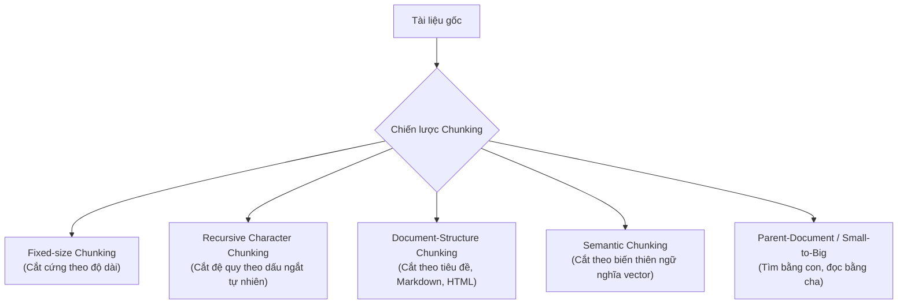

### 1. Fixed-size Chunking (Phân đoạn theo kích thước cố định)
- **Cách làm:** Đặt một con số cố định (ví dụ: đúng 500 ký tự hoặc 200 tokens) rồi cắt thẳng tay.
- **Ưu điểm:** Cực kỳ nhanh, dễ cài đặt nhất.
- **Nhược điểm:** Tồi tệ nhất về mặt ngữ nghĩa. Rất dễ cắt đứt đôi một câu, một từ hoặc một bảng số liệu, làm mất hoàn toàn ngữ nghĩa của đoạn văn.

### 2. Recursive Character Chunking (Cắt đệ quy theo ký tự)
- **Cách làm:** Đây là phương pháp phổ biến nhất trong LangChain/LlamaIndex. Thuật toán sử dụng một danh sách các ký tự phân tách ưu tiên: `["\n\n", "\n", " ", ""]`.
  - Đầu tiên, nó cố gắng tách tài liệu theo đoạn văn (`\n\n`).
  - Nếu đoạn văn nào vẫn dài hơn `chunk_size`, nó tiếp tục tách đoạn đó theo từng câu (`\n` hoặc dấu chấm).
  - Nếu câu vẫn quá dài, nó mới tách theo từ (` `) hoặc ký tự.
- **Ưu điểm:** Giữ được sự toàn vẹn của cấu trúc đoạn văn và câu một cách tối đa.

### 3. Document-Structure / Layout-aware Chunking (Cắt theo cấu trúc tài liệu)
- **Cách làm:** Phân tích cú pháp tài liệu dựa trên định dạng gốc:
  - **Markdown:** Cắt theo các tiêu đề `# H1`, `## H2`, `### H3`.
  - **HTML:** Cắt theo thẻ `
`, `<section>`, `<article>`, `
`.
  - **Code:** Cắt theo phạm vi hàm (functions) hoặc lớp (classes).
  - **JSON/Table:** Giữ nguyên từng hàng hoặc từng object.
- **Ưu điểm:** Mỗi chunk tương ứng với một đơn vị kiến thức logic trọn vẹn do tác giả tài liệu chủ động phân chia.

### 4. Semantic Chunking (Phân đoạn theo khoảng cách ngữ nghĩa)
- **Cách làm:** 
  1. Tách văn bản thành từng câu đơn lẻ.
  2. Tạo embedding vector cho từng câu.
  3. Tính khoảng cách Cosine giữa câu thứ $i$ và câu thứ $i+1$.
  4. Nếu khoảng cách vượt qua một ngưỡng (nghĩa là chủ đề đột ngột chuyển sang hướng khác), đặt một điểm cắt chunk tại đó.
- **Ưu điểm:** Các câu trong cùng một chunk đảm bảo 100% gắn kết về mặt ý nghĩa.
- **Nhược điểm:** Tốn kém chi phí và thời gian vì phải gọi embedding cho từng câu đơn lẻ.

### 5. Parent-Document / Hierarchical Chunking (Mô hình Small-to-Big)
- **Cách làm:** 
  - Tạo ra 2 mức chunk: **Parent Chunk** (lớn, khoảng 1000 - 2000 tokens) và **Child Chunk** (nhỏ, khoảng 100 - 200 tokens).
  - Chỉ nhúng Child Chunk vào Vector Database để tìm kiếm.
  - Khi một Child Chunk được tìm thấy, hệ thống sẽ lấy ID của Parent Chunk tương ứng và nạp toàn bộ Parent Chunk vào Context Window cho LLM.
- **Ưu điểm:** Giải quyết hoàn hảo bài toán đối nghịch: **Chunk nhỏ giúp tìm kiếm chuẩn xác từng từ khóa**, trong khi **Chunk lớn giúp LLM có đầy đủ ngữ cảnh để trả lời**.

---

## 4.3 Chunk Size và Chunk Overlap

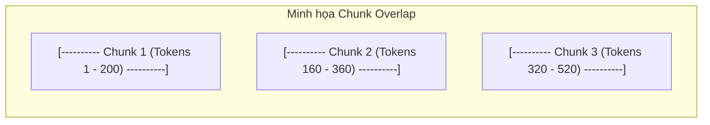

### Chunk Size là gì?
`chunk_size` là độ dài tối đa của một phân đoạn (được đo bằng số ký tự hoặc số token).
- **Chunk Size nhỏ (128 - 256 tokens):** Rất tốt cho việc tìm kiếm các dữ kiện cụ thể, định nghĩa, số liệu chính xác. Nhưng dễ làm mất bối cảnh vĩ mô.
- **Chunk Size lớn (512 - 1500 tokens):** Giữ được trọn vẹn câu chuyện, lập luận, hướng dẫn nhiều bước. Nhưng vector embedding có thể bị loãng và giảm độ chính xác khi tìm kiếm.

### Chunk Overlap là gì?
`chunk_overlap` là số lượng token/ký tự được lặp lại ở phần giáp ranh giữa hai chunk liên tiếp (thường được thiết lập bằng $10\% - 20\%$ của `chunk_size`).

#### Tại sao bắt buộc phải có Chunk Overlap?
Nếu không có overlap, một câu văn hoặc một ý trọn vẹn vô tình nằm ngay điểm cắt sẽ bị chẻ làm đôi:
- *Ví dụ:* Một câu quan trọng: `"Doanh thu quý 3 đạt 50 tỷ đồng, tăng trưởng 20% so với cùng kỳ."`
  - Nếu cắt không có overlap:
    - **Chunk 1:** `"... Doanh thu quý 3 đạt 50 tỷ đồng,"` (thiếu phần tăng trưởng).
    - **Chunk 2:** `"tăng trưởng 20% so với cùng kỳ..."` (thiếu chủ thể doanh thu là của quý nào).
  - Khi người dùng hỏi *"Doanh thu quý 3 tăng trưởng bao nhiêu?"*, cả 2 chunk đều không đủ thông tin độc lập để khớp với query vector!
- Nhờ có overlap, câu văn đó sẽ xuất hiện trọn vẹn ở cả phần đuôi của Chunk 1 và phần đầu của Chunk 2.

---

## 4.4 Ảnh hưởng của chiến lược Chunking đến chất lượng Retrieval

Chiến lược chunking quyết định trực tiếp tới 2 chỉ số sống còn của hệ thống RAG:
1. **Recall:** Khả năng tìm thấy tất cả các đoạn văn có liên quan trong kho dữ liệu khổng lồ.
2. **Precision:** Tỉ lệ thông tin thực sự hữu ích trong số các đoạn văn được mang về (không mang rác/thông tin nhiễu vào prompt).

### Ma trận lựa chọn chiến lược Chunking theo loại tài liệu

| Loại tài liệu | Kích thước đề xuất | Overlap đề xuất | Phương pháp tối ưu | Lý do |
| :--- | :--- | :--- | :--- | :--- |
| **Hợp đồng, Văn bản pháp luật** | 300 - 500 tokens | 15% - 20% | Recursive / Markdown (theo Điều, Khoản) | Các điều khoản có tính ràng buộc chặt chẽ, không được cắt ngang điều luật |
| **Mã nguồn (Source Code)** | Theo độ dài hàm | 0% - 10% | Language-specific (theo Function/Class AST) | Cắt vụn code sẽ gây lỗi cú pháp và mất phạm vi biến (scope) |
| **Bài báo khoa học, Sách giáo khoa** | 500 - 1000 tokens | 10% - 15% | Hierarchical (Small-to-Big) | Cần tìm chính xác định nghĩa nhưng khi giải thích cần toàn bộ đoạn lập luận |
| **Dữ liệu hỏi đáp (FAQ), Customer Support** | Kích thước 1 cặp Q&A | 0% | Fixed / Structure (1 câu hỏi + 1 câu trả lời = 1 chunk) | Mỗi câu hỏi-đáp là một đơn vị tri thức khép kín, không cần overlap |
| **Bảng biểu tài chính, CSV** | Theo từng dòng / Bảng | 0% | Markdown Table / JSON format | Cắt đôi bảng số liệu sẽ làm mất tiêu đề cột, dẫn đến LLM đọc sai số liệu |

---

# PHẦN 5: INFORMATION ANALYSIS & SYNTHESIS

## 5.1 Các phương pháp phân tích và trích xuất thông tin từ dữ liệu

Để đưa dữ liệu vào hệ thống AI một cách hiệu quả, quá trình trích xuất thông tin (Information Extraction - IE) đóng vai trò biến văn bản thô thành tri thức có thể lập chỉ mục:

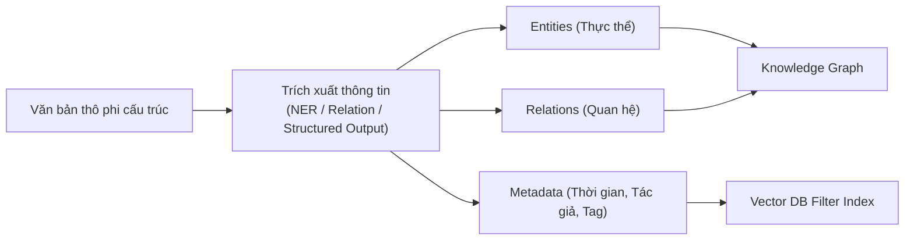

1. **Nhận dạng thực thể có tên (Named Entity Recognition - NER):**
   Tự động xác định và gán nhãn các đối tượng trong văn bản: Con người (`PERSON`), Tổ chức (`ORG`), Địa điểm (`GPE`), Mốc thời gian (`DATE`), Số tiền (`MONEY`).
2. **Trích xuất quan hệ (Relation Extraction):**
   Xác định mối liên kết ngữ nghĩa giữa các thực thể theo dạng bộ ba (Triplets): `(Chủ thể - Mối quan hệ - Khách thể)`.
   *Ví dụ:* `(Sam Altman) - [CEO of] -> (OpenAI)`. Đây là nền tảng để xây dựng **GraphRAG (Knowledge Graph RAG)**.
3. **Trích xuất có cấu trúc (Structured Outputs / Schema Extraction):**
   Sử dụng LLM kết hợp với Pydantic hoặc JSON Schema để ép kiểu đầu ra của các văn bản lộn xộn (như hóa đơn, email, phản hồi khách hàng) thành cấu trúc JSON chuẩn mực.
4. **Metadata Enrichment (Làm giàu siêu dữ liệu):**
   Gắn thêm các thuộc tính vào từng chunk trước khi lưu vào Vector DB: `created_at`, `source_url`, `author`, `department`, `topic_classification`. Nhờ đó, người dùng có thể kết hợp tìm kiếm ngữ nghĩa với bộ lọc metadata (`filter: {"department": "HR", "year": 2024}`).

---

## 5.2 Cách tổ chức, phân loại và tổng hợp thông tin từ nhiều nguồn

Khi xây dựng hệ sinh thái AI doanh nghiệp, thông tin thường nằm rải rác ở hàng chục nguồn: Confluence, Google Drive, Jira, cơ sở dữ liệu nội bộ, email.

### Các mô hình tổng hợp thông tin phổ biến:
1. **Map-Reduce Synthesis:**
   - **Map:** Với mỗi tài liệu/nguồn, gọi một LLM chạy song song để tóm tắt các điểm chính liên quan đến câu hỏi.
   - **Reduce:** Gom tất cả các bản tóm tắt thành phần lại, gửi vào một LLM tổng để hợp nhất thành một báo cáo duy nhất.
2. **Refine / Sequential Synthesis:**
   - LLM đọc nguồn tài liệu thứ nhất và viết ra câu trả lời ban đầu.
   - Sau đó đọc nguồn tài liệu thứ hai để tinh chỉnh, bổ sung thêm ý. Lặp lại tuần tự cho đến tài liệu cuối cùng. Phù hợp khi tài liệu có tính nối tiếp dòng thời gian.
3. **Tree of Summaries (Phân cụm phân cấp):**
   - Phân cụm các tài liệu liên quan thành các nhóm nhỏ bằng thuật toán K-Means hoặc HDBSCAN trên không gian vector.
   - Tóm tắt từng cụm nhỏ, sau đó tóm tắt các bản tóm tắt ở tầng cao hơn.

---

## 5.3 Keyword Search và Semantic Search

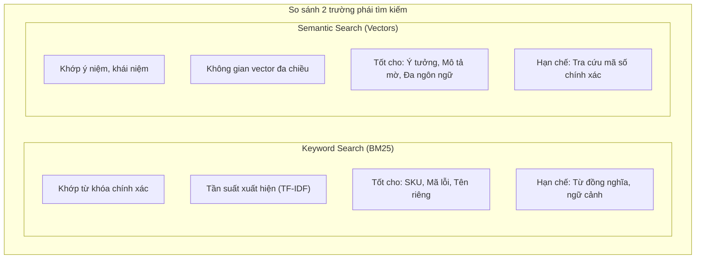

### So sánh chi tiết

| Tiêu chí | Keyword Search (Từ khóa / Lexical) | Semantic Search (Ngữ nghĩa / Dense) |
| :--- | :--- | :--- |
| **Thuật toán đại diện** | **BM25**, TF-IDF, Inverted Index | **HNSW**, IVF, Cosine Similarity trên Vector |
| **Nguyên lý** | Đếm số lần xuất hiện của các từ trong query xuất hiện trong tài liệu (khớp mặt chữ) | So sánh khoảng cách góc giữa 2 vector trong không gian ngữ nghĩa |
| **Từ đồng nghĩa** | Thất bại (Tìm "ô tô" sẽ không thấy bài viết chứa từ "xe hơi") | Hoàn hảo (Hiểu "ô tô", "xe hơi", "xế hộp" là cùng một bản chất) |
| **Mã định danh / Tên riêng** | Cực kỳ xuất sắc (Tìm mã lỗi `ERR_404_NOT_FOUND` hoặc mã nhân viên `ID-9921`) | Kém (Các từ hiếm hoặc mã số ngẫu nhiên không có vị trí rõ ràng trong không gian embedding) |
| **Khả năng hiểu ý định** | Không hiểu (Dễ bị sai khi có phủ định, ngữ pháp phức tạp) | Rất tốt (Hiểu sự khác biệt giữa "người cắn chó" và "chó cắn người") |
| **Độ nhạy chính tả** | Dễ bị ảnh hưởng nếu sai chính tả (cần module Fuzzy match phụ trợ) | Tương đối mạnh mẽ, chịu lỗi sai chính tả nhẹ tốt |

---

## 5.4 Hybrid Search và Reranking

### Hybrid Search (Tìm kiếm lai)
Để khắc phục điểm yếu của cả hai phương pháp trên, các hệ thống tìm kiếm hiện đại kết hợp cả **Keyword Search (Sparse)** và **Semantic Search (Dense)**:

$$\text{Final Candidates} = \text{Top-K}(\text{BM25}) \cup \text{Top-K}(\text{Vector Search})$$

#### Thuật toán Reciprocal Rank Fusion (RRF):
Làm sao kết hợp điểm số của BM25 (điểm từ 0 đến hàng chục) với điểm Cosine (điểm từ 0 đến 1)? Thuật toán **RRF** không dùng điểm số thô mà dùng **thứ hạng (rank)** của tài liệu trong từng danh sách:

$$RRF(d) = \sum_{m \in M} \frac{1}{k + r_m(d)}$$

Trong đó:
- $M$ là tập hợp các phương pháp tìm kiếm (ví dụ: $M = \{\text{BM25}, \text{Vector}\}$).
- $r_m(d)$ là thứ hạng của tài liệu $d$ trong phương pháp $m$ (1, 2, 3...).
- $k$ là một hằng số làm mượt (smoothing factor, thường chọn $k = 60$).

---

### Reranking (Kiến trúc 2-Stage Retrieval)
Tìm kiếm vector dựa trên **Bi-Encoder** (nhúng câu hỏi riêng, nhúng tài liệu riêng rồi tính tích vô hướng). Ưu điểm là cực nhanh, nhưng nhược điểm là hai bên không được "nhìn thấy nhau" trong quá trình tính toán ngữ cảnh.

Để đạt chất lượng cao nhất, người ta sử dụng mô hình **Cross-Encoder (Reranker)** trong quy trình 2 giai đoạn:

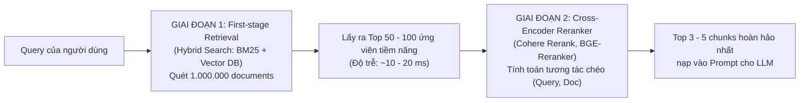

- **Giai đoạn 1 (Fast Retrieval):** Sử dụng Hybrid Search quét qua hàng triệu tài liệu trong vài chục mili-giây để sàng lọc lấy ra khoảng 50 - 100 tài liệu khả dĩ nhất.
- **Giai đoạn 2 (Deep Reranking):** Đưa từng cặp `(Query, Document)` đi qua một mô hình Cross-Encoder chuyên sâu. Cross-Encoder tính toán ma trận Attention toàn diện giữa từng từ của câu hỏi với từng từ của đoạn văn, chấm điểm liên quan từ 0.0 đến 1.0 với độ chính xác vượt trội, sau đó sắp xếp lại và chỉ lấy ra Top 3 - 5 kết quả tốt nhất.

---

## 5.5 Các vấn đề khi xử lý thông tin trùng lặp, mâu thuẫn hoặc thiếu ngữ cảnh

Khi thu thập dữ liệu từ nhiều nguồn, hệ thống AI chắc chắn sẽ đối mặt với 3 "căn bệnh" phổ biến sau:

### 1. Xử lý thông tin trùng lặp (Redundancy / Deduplication)
- **Vấn đề:** 5 văn bản khác nhau cùng chép lại một thông báo, hoặc nhiều chunk chứa nội dung na ná nhau cùng lọt vào Top-K, chiếm hết chỗ trong Context Window mà không đem lại thông tin mới.
- **Giải pháp:**
  - **Deduplication bằng Hash:** Dùng MD5/SHA256 để lọc các đoạn trùng lặp 100% khi nhập dữ liệu.
  - **Near-deduplication (Trùng lặp một phần):** Dùng thuật toán MinHash / SimHash hoặc đo Cosine Distance giữa các chunks. Nếu hai chunk có độ tương đồng $> 0.92$, chỉ giữ lại một chunk duy nhất.
  - **Maximal Marginal Relevance (MMR):** Thuật toán tìm kiếm cân bằng giữa **độ liên quan với câu hỏi** và **sự đa dạng giữa các kết quả**:
    $$\text{MMR} = \arg\max_{d_i \in R \setminus S} \left[ \lambda \cdot \text{Sim}_1(d_i, q) - (1 - \lambda) \max_{d_j \in S} \text{Sim}_2(d_i, d_j) \right]$$
    (Chọn tài liệu vừa gần query $q$, vừa xa các tài liệu $d_j$ đã được chọn trước đó).

---

### 2. Xử lý thông tin mâu thuẫn (Contradiction / Conflict Resolution)
- **Vấn đề:** Nguồn A viết: *"Chính sách làm việc từ xa áp dụng 2 ngày/tuần"*; Nguồn B viết: *"Bắt buộc nhân viên có mặt tại văn phòng 100% thời gian"*. AI sẽ trả lời thế nào?
- **Giải pháp:**
  - **Độ tươi mới của dữ liệu (Temporal Resolution):** Sử dụng metadata `timestamp` / `version`. Luôn ưu tiên tài liệu có ngày cập nhật mới nhất và thông báo cho người dùng sự thay đổi theo thời gian.
  - **Trọng số nguồn tin cậy (Authority / Source Weighting):** Gán mức độ ưu tiên: Tài liệu từ Cổng thông tin chính thức của Pháp chế/Ban điều hành $>$ Ghi chú họp của nhóm $>$ Tin nhắn chat trên Slack.
  - **Multi-perspective Presentation (Nêu đa chiều quan điểm):** Khi không thể xác định nguồn nào đúng tuyệt đối, prompt ép LLM phải trình bày cả hai luồng thông tin:
    > *"Theo tài liệu chính sách cập nhật tháng 3/2024 thì..., tuy nhiên thông báo nội bộ ngày 15/05/2024 lại ghi nhận rằng..."*

---

### 3. Xử lý thông tin thiếu ngữ cảnh (Context Scarcity / Contextual Incompleteness)
- **Vấn đề:** Một chunk sau khi cắt ra có nội dung: `"Chi phí cho dự án này là 20.000 USD."` $\implies$ *Dự án này là dự án nào? Trong năm nào? Khách hàng nào?* Chunk hoàn toàn vô dụng nếu đứng một mình.
- **Giải pháp:**
  - **Contextual Retrieval (Kỹ thuật của Anthropic):** Trước khi tạo embedding cho một chunk, dùng một LLM nhỏ sinh ra 1-2 câu giải thích ngắn gọn về bối cảnh của chunk đó trong toàn bộ tài liệu và ghép vào đầu chunk:
    > *"[Ngữ cảnh: Trích từ đề xuất dự án CRM cho công ty ABC vào tháng 1/2024] Chi phí cho dự án này là 20.000 USD."*
  - **Parent Document Retrieval:** Luôn liên kết chunk nhỏ với chunk cha để khi tìm thấy thì mang cả bối cảnh xung quanh vào prompt.
  - **HyDE (Hypothetical Document Embeddings):** Khi câu hỏi của người dùng quá ngắn hoặc mơ hồ, dùng LLM sinh ra một câu trả lời giả định (hypothetical answer), sau đó dùng chính câu trả lời giả định này đi tìm kiếm trong Vector DB. Vector của câu trả lời giả định sẽ gần với các tài liệu thực tế hơn nhiều so với vector của một câu hỏi cụ thể.

---

## TỔNG KẾT BẢN ĐỒ KIẾN TRÚC HỆ THỐNG HIỆN ĐẠI

Sơ đồ dưới đây xâu chuỗi toàn bộ 5 phần kiến thức thành một luồng hệ thống AI hoàn chỉnh chuẩn công nghiệp:

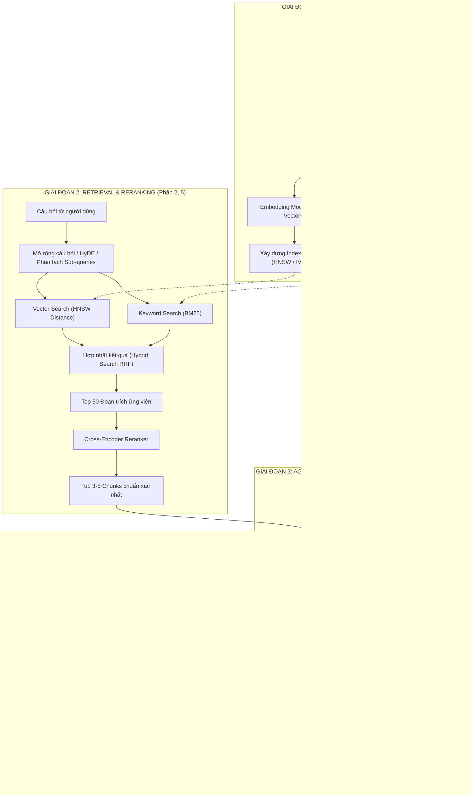

---
*Tài liệu được biên soạn phục vụ học tập, nghiên cứu và xây dựng các hệ sinh thái AI / RAG chuyên sâu.*

