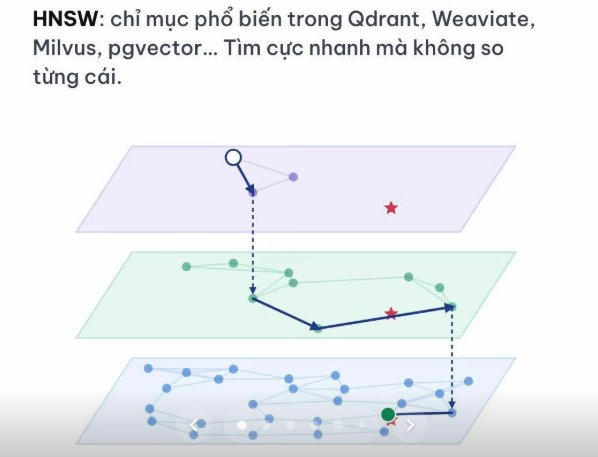
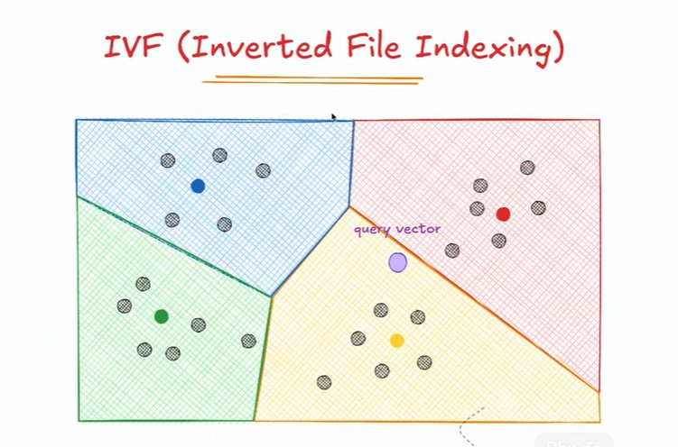
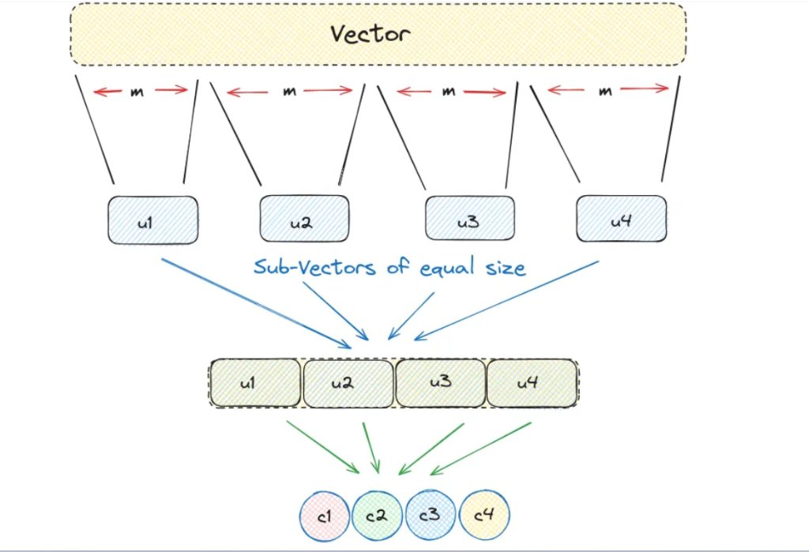

# 1. Vector & Vector Database

### Vector là gì? Vector được sử dụng như thế nào trong AI/ML?
- Vector là gì:
  - Về mặt toán học, Vector là một mảng số thực có thứ tự trong không gian nhiều chiều: $\mathbf{v} = [v_1, v_2, \dots, v_d] \in \mathbb{R}^d$, trong đó $d$ là số chiều (dimensions).
  - Trong AI hiện đại, vector thường có từ vài trăm đến hàng nghìn chiều 
- Cách sử dụng trong AI/ML:
  - Biểu diễn đặc trưng (Feature Representation): Chuyển đổi mọi loại dữ liệu thô (chữ viết, điểm ảnh, sóng âm) thành vector để mạng nơ-ron có thể hiểu và tính toán.
  - Lưu trữ tri thức: Toàn bộ trọng số (weights) và trạng thái ẩn (hidden states) của các mô hình AI/LLM đều là vector và ma trận.
  - So sánh tương đồng ngữ nghĩa (Similarity Search): Quy bài toán so sánh ý nghĩa ngôn ngữ về bài toán đo khoảng cách hình học giữa các điểm vector trong không gian.

---

### Embedding là gì? Quá trình chuyển đổi dữ liệu thành vector diễn ra như thế nào?
- Khái niệm Embedding:
  - Kỹ thuật ánh xạ một đối tượng (từ, câu, hình ảnh) thành một vector số thực liên tục.
  - Đảm bảo các đối tượng có ý nghĩa tương đồng sẽ nằm gần nhau trong không gian vector.
- Quá trình chuyển đổi văn bản thành vector:
  - Bước 1 - Tokenization: Văn bản thô được bẻ nhỏ thành chuỗi token và ánh xạ thành dãy số nguyên (Token IDs).
  - Bước 2 - Lookup & Positional Encoding: Mỗi token được gắn một vector ban đầu và cộng thêm vector vị trí để mô hình nhận diện thứ tự từ.
  - Bước 3 - Tương tác ngữ cảnh (Self-Attention qua Transformer): Các từ giao tiếp và hấp thu ngữ cảnh xung quanh để tạo ra biểu diễn chính xác (từ "ngân hàng" trong kinh tế sẽ có vector khác "ngân hàng" bờ sông).
  - Bước 4 - Pooling: Gom toàn bộ ma trận các vector token thành 1 vector duy nhất đại diện cho cả đoạn (qua `Mean Pooling` hoặc lấy vector của token `[CLS]`), sau đó thường chuẩn hóa về độ dài $L_2$ norm = 1.

---

### Vector Database là gì? Khác biệt với Database truyền thống?
- Khái niệm Vector Database:
  - Là hệ quản trị cơ sở dữ liệu chuyên biệt để lưu trữ, lập chỉ mục (indexing) và tìm kiếm độ tương đồng trên hàng triệu đến hàng tỷ vector kèm metadata với độ trễ tính bằng mili-giây.
- Khác biệt với Database truyền thống:

| Tiêu chí | Vector Database (Pinecone, Milvus, Qdrant) | Database truyền thống (PostgreSQL, MySQL, MongoDB) |
| :--- | :--- | :--- |
| **Dữ liệu chính** | Vector đa chiều kèm metadata | Dữ liệu dạng bảng (hàng/cột), JSON, Key-Value |
| **Cách truy vấn** | **Tìm kiếm tương đồng ngữ nghĩa** (Cosine, Dot, Euclidean) | **Khớp chính xác** (`WHERE id = 5`, `LIKE '%abc%'`, `JOIN`) |
| **Cơ chế Index** | Thuật toán xấp xỉ ANN (HNSW, IVF, PQ, ScaNN) | Cấu trúc cây/băm (B-Tree, B+Tree, Hash Index) |
| **Loại dữ liệu mạnh** | Dữ liệu phi cấu trúc (văn bản, ảnh, âm thanh, video) | Dữ liệu có cấu trúc hoặc bán cấu trúc rõ ràng |
| **Ứng dụng điển hình** | RAG cho AI, tìm kiếm ngữ nghĩa, nhận diện ảnh/khuôn mặt | Giao dịch tài chính (ACID), quản lý đơn hàng, hồ sơ người dùng |

---

### Các phép đo độ tương đồng giữa vector (Cosine Similarity, Dot Product, Euclidean Distance)
- Cosine Similarity (Độ tương đồng Cosine):
  - Đo góc lệch giữa hai vector, không phụ thuộc vào độ dài (độ lớn vector).
  - Công thức: $\text{Cosine}(\mathbf{u}, \mathbf{v}) = \frac{\mathbf{u} \cdot \mathbf{v}}{\|\mathbf{u}\| \|\mathbf{v}\|} = \frac{\sum u_i v_i}{\sqrt{\sum u_i^2}\sqrt{\sum v_i^2}}$
  - Giá trị thuộc $[-1, 1]$ (1 là hoàn toàn trùng hướng/ý nghĩa).
  - Phù hợp nhất cho văn bản (Text Embeddings) vì độ dài câu văn không làm lệch ý nghĩa.
- Dot Product (Tích vô hướng / Inner Product):
  - Đo cả góc lệch lẫn độ lớn (magnitude) của vector.
  - Công thức: $\mathbf{u} \cdot \mathbf{v} = \sum_{i=1}^d u_i v_i$
  - Khi vector đã được chuẩn hóa độ dài về 1 ($\|\mathbf{u}\| = \|\mathbf{v}\| = 1$), Dot Product chính là Cosine Similarity nhưng tính toán nhanh hơn.
- Euclidean Distance (Khoảng cách Euclid / $L_2$ Distance):
  - Đo khoảng cách đường thẳng hình học giữa hai điểm đầu mút vector.
  - Công thức: $d(\mathbf{u}, \mathbf{v}) = \sqrt{\sum_{i=1}^d (u_i - v_i)^2}$
  - Khoảng cách càng nhỏ thì hai đối tượng càng giống nhau ($d = 0$ là trùng nhau).
  - Phù hợp cho xử lý hình ảnh, âm thanh hoặc dữ liệu mà độ lớn của đặc trưng có ý nghĩa quan trọng.

---

# 2. Vector Database Search Algorithms

### Các phương pháp tìm kiếm vector phổ biến
- Tree-based (KD-Tree, Annoy):
  - Phân chia không gian bằng các siêu phẳng (hyperplanes) thành cấu trúc cây nhị phân.
- Inverted File (IVF):
  - Phân cụm không gian vector thành các vùng Voronoi cells.
- Graph-based (HNSW):
  - Xây dựng mạng lưới liên kết láng giềng nhiều tầng.
- Quantization-based (PQ, SCaNN):
  - Nén dữ liệu vector thành các mã chỉ mục nhỏ để tiết kiệm RAM.

---

### Exact Search và Approximate Nearest Neighbor (ANN)
- Exact Search (k-NN / Brute-force / Flat):
  - Đo khoảng cách từ truy vấn tới toàn bộ vector trong kho dữ liệu.
  - Độ chính xác tuyệt đối (Recall = 100%).
  - Độ phức tạp $O(N \cdot d)$, rất chậm khi dữ liệu lớn ($N > 1.000.000$).
- Approximate Nearest Neighbor (ANN):
  - Dùng cấu trúc đồ thị, phân cụm hoặc băm để chỉ duyệt các vùng tiềm năng nhất.
  - Chấp nhận sai số nhỏ nhưng độ chính xác vẫn rất cao (Recall đạt 95% – 99%).
  - Độ phức tạp giảm xuống $O(\log N)$ hoặc $O(1)$, tốc độ phản hồi tính bằng mili-giây.

---

### Nguyên lý hoạt động cơ bản của HNSW, IVF và PQ
- HNSW (Hierarchical Navigable Small World):
  - Xây dựng mạng lưới đồ thị nhiều tầng (tương tự cấu trúc Skip-List).
  - Bắt đầu từ tầng cao nhất (thưa nhất) để nhảy những bước xa đến gần vùng đích, sau đó tụt dần xuống tầng dưới (dày đặc hơn) để dò tìm láng giềng gần nhất.

- IVF (Inverted File Index):
  - Dùng thuật toán $K$-Means chia không gian vector thành $k$ cụm (Voronoi cells).
  - Khi tìm kiếm, chỉ xác định vài tâm cụm ($Centroids$) gần truy vấn nhất (qua tham số `nprobe`), rồi chỉ quét các vector bên trong các cụm đó.

- PQ (Product Quantization):
  - Kỹ thuật nén vector bằng cách chia vector $d$ chiều thành $m$ phần nhỏ (sub-vectors).
  - Áp dụng phân cụm để ánh xạ từng phần nhỏ về một giá trị mã centroid (Codebook).
  - Giúp giảm dung lượng bộ nhớ từ 4x đến 16x và tăng tốc độ tính khoảng cách bằng bảng tra cứu.

---

### Ưu nhược điểm và trường hợp sử dụng của từng phương pháp
- So sánh ưu nhược điểm và ứng dụng:

| Phương pháp | Ưu điểm | Nhược điểm | Trường hợp sử dụng phù hợp |
| :--- | :--- | :--- | :--- |
| **HNSW** | Tốc độ truy vấn siêu nhanh, Recall cực cao (98–99%) | Tốn nhiều RAM nhất, build index tốn thời gian và CPU | Hệ thống yêu cầu độ trễ thấp (< 10ms), độ chính xác cao và có ngân sách RAM dồi dào. |
| **IVF** | Tiết kiệm RAM hơn HNSW, tốc độ tạo index nhanh | Phải tuning kỹ tham số `nlist`, `nprobe` để cân bằng tốc độ và Recall | Dữ liệu quy mô lớn, tài nguyên máy chủ bộ nhớ vừa phải. |
| **PQ / IVF-PQ** | Tiết kiệm 75–90% RAM, chứa được hàng trăm triệu vector trên 1 máy | Giảm độ chính xác (mất mát dữ liệu do nén) | Database quy mô cực lớn (hàng chục đến hàng trăm triệu vector), chi phí phần cứng giới hạn. |

---

# 3. AI Memory Management

### AI Memory là gì? Cách AI quản lý và sử dụng thông tin
- Khái niệm AI Memory:
  - Là cơ chế lưu trữ, duy trì ngữ cảnh và khôi phục thông tin cá nhân hóa qua các phiên hội thoại.
  - Giúp AI ghi nhớ lâu dài mà không cần huấn luyện lại mô hình (fine-tuning).
- Cách AI quản lý và sử dụng thông tin:
  - Thu nhận: Ghi nhận thông tin từ các lượt trò chuyện của người dùng.
  - Phân tích & Trích xuất: Bóc tách các dữ kiện quan trọng, sở thích, thông tin cá nhân.
  - Lưu trữ: Lưu vào cơ sở dữ liệu chuyên dụng (Vector DB, Knowledge Graph hoặc Cache).
  - Truy xuất & Tái sử dụng: Khi nhận câu hỏi mới, tìm lại các mảnh ký ức liên quan nhất để nạp vào Prompt làm ngữ cảnh trả lời.

---

### Short-term Memory và Long-term Memory
- Short-term Memory (Bộ nhớ ngắn hạn):
  - Chứa ngữ cảnh tức thời trong phiên trò chuyện hiện tại (vài câu hỏi - đáp gần nhất).
  - Tồn tại tạm thời trong RAM / Context Window và sẽ mất khi kết thúc phiên hội thoại.
- Long-term Memory (Bộ nhớ dài hạn):
  - Lưu trữ sở thích cá nhân, thông tin lịch sử, sự kiện kéo dài qua nhiều tuần, tháng hoặc năm.
  - Được lưu bền vững vào cơ sở dữ liệu (Vector DB, Graph DB, Relational DB) và truy xuất khi cần.

---

### Context Window, Conversation History và Memory khác nhau như thế nào?
- Phân biệt 3 khái niệm:

| Khái niệm | Bản chất | Đặc điểm / Phạm vi |
| :--- | :--- | :--- |
| **Context Window** | Giới hạn dung lượng token tối đa mà LLM có thể tiếp nhận trong một lượt suy luận | Giới hạn phần cứng/mô hình cố định (ví dụ: 128k, 1M token). Vượt quá sẽ bị lỗi hoặc tràn bộ nhớ. |
| **Conversation History** | Toàn bộ nhật ký hội thoại dạng văn bản thô giữa người dùng và trợ lý | Dài vô tận theo thời gian; nếu đưa hết vào Context Window sẽ làm chậm hệ thống và tốn chi phí. |
| **Memory** | Thông tin **đã qua xử lý, trích xuất và cô đọng** từ lịch sử hội thoại | Tồn tại độc lập; được chọn lọc có chủ đích để nạp một lượng vừa đủ vào Context Window. |

---

### Các phương pháp lưu trữ, truy xuất và cập nhật Memory
- Phương pháp lưu trữ (Storage):
  - Vector Memory: Lưu các đoạn trích dưới dạng vector embedding để tìm kiếm theo độ tương đồng.
  - Entity/Graph Memory: Lưu các thực thể và mối quan hệ (ví dụ: `User` $\to$ `sống tại` $\to$ `Hà Nội`).
  - Summary Buffer: Tóm tắt định kỳ các lượt chat cũ thành một đoạn văn ngắn gọn.
- Phương pháp truy xuất (Retrieval):
  - Dựa trên độ tương đồng ngữ nghĩa (Relevance).
  - Kết hợp thời gian xuất hiện (Recency) và mức độ quan trọng (Importance).
- Phương pháp cập nhật (Update):
  - Consolidation: Gom các mẩu ký ức rời rạc thành một kết luận khái quát.
  - Conflict Resolution: Tự động ghi đè hoặc hạ độ ưu tiên của dữ liệu cũ khi có thông tin mới mâu thuẫn.

---

# 4. Chunking Strategies

### Chunking là gì? Tại sao cần Chunking?
- Định nghĩa Chunking:
  - Là kỹ thuật bẻ nhỏ một tài liệu lớn (sách, báo cáo, web) thành các đoạn văn ngắn hơn (chunks) trước khi tạo embedding.
- Tại sao cần Chunking:
  - Khắc phục giới hạn của Embedding Model: Các mô hình embedding chỉ nhận tối đa 512 hoặc 8192 token mỗi lần.
  - Tránh pha loãng ngữ nghĩa (Semantic Dilution): Tài liệu quá dài chứa nhiều ý khiến vector đại diện bị nhiễu, làm giảm độ chính xác khi tìm kiếm.
  - Tối ưu hóa Context Window: Chỉ nạp đúng đoạn thông tin chứa câu trả lời thay vì nạp toàn bộ tài liệu cồng kềnh.

---

### Các phương pháp Chunking phổ biến
- Fixed-size Chunking (Cắt theo kích thước cố định):
  - Cắt theo số ký tự hoặc token cố định (ví dụ: mỗi chunk 500 ký tự).
  - Ưu điểm là đơn giản, nhược điểm là dễ làm đứt đoạn câu và mất nghĩa.
- Recursive Character Chunking (Cắt đệ quy theo dấu ngắt tự nhiên):
  - Ngắt văn bản theo thứ tự ranh giới tự nhiên: đoạn văn (`\n\n`) $\to$ dòng (`\n`) $\to$ câu (`. `) $\to$ từ (` `).
  - Giữ trọn vẹn ngữ nghĩa của câu văn, là phương pháp chuẩn và phổ biến nhất trong RAG.
- Document-based / Structural Chunking (Cắt theo cấu trúc):
  - Cắt dựa theo cấu trúc định dạng file: tiêu đề Markdown (`#`, `##`), thẻ HTML (`<h1>`, `
`), bảng biểu hoặc cấu trúc code/JSON.
- Semantic Chunking (Cắt theo ngữ nghĩa):
  - Đo khoảng cách ngữ nghĩa giữa các câu liên tiếp bằng embedding.
  - Tự động ngắt đoạn khi phát hiện tác giả chuyển sang chủ đề mới.

---

### Chunk Size và Chunk Overlap
- Chunk Size (Kích thước đoạn):
  - Nhỏ (100–300 token): Tìm kiếm rất trúng vào tiểu tiết, nhưng dễ thiếu ngữ cảnh bao quát.
  - Lớn (800–1500 token): Ngữ cảnh đầy đủ, nhưng vector dễ bị pha loãng và giảm độ chính xác khi đối sánh.
- Chunk Overlap (Độ gối đầu):
  - Lặp lại một phần văn bản ở cuối chunk trước vào đầu chunk sau (thường từ 10% đến 20% Chunk Size).
  - Đảm bảo các ý tưởng nằm ở ranh giới cắt không bị đứt đoạn hoặc mất mạch nội dung.

---

### Ảnh hưởng của chiến lược Chunking đến chất lượng Retrieval
- Rủi ro khi chọn sai kích thước:
  - Chunk quá lớn: Vector phản ánh trung bình cộng của nhiều chủ đề $\to$ điểm tương đồng giảm, tìm kiếm dễ bị trượt.
  - Chunk quá nhỏ: Thông tin trả về vụn vặt, thiếu bối cảnh $\to$ LLM không đủ dữ liệu để trả lời và dễ sinh ra ảo giác (Hallucination).
- Giải pháp tối ưu:
  - Sử dụng kỹ thuật Parent-Document Retrieval: Tìm kiếm trên Small Chunks để đạt độ chính xác cao, nhưng nạp cả Parent Chunk lớn chứa nó vào Prompt cho LLM đọc.

---

# 5. Information Analysis & Synthesis

### Các phương pháp phân tích và trích xuất thông tin từ dữ liệu
- Named Entity Recognition (NER):
  - Nhận diện và bóc tách các thực thể cụ thể như tên người, tổ chức, địa điểm, ngày tháng, mã sản phẩm.
- Relation Extraction:
  - Xác định mối quan hệ ngữ nghĩa giữa các thực thể (ví dụ: `[A] là CEO của [B]`).
- Structured Extraction via LLM:
  - Yêu cầu LLM đọc hiểu dữ liệu phi cấu trúc và xuất ra định dạng JSON/Schema rõ ràng.
- Text Summarization:
  - Tóm tắt nội dung văn bản theo dạng trích xuất câu gốc (extractive) hoặc viết lại cô đọng (abstractive).

---

### Cách tổ chức, phân loại và tổng hợp thông tin từ nhiều nguồn
- Chuẩn hóa dữ liệu (Normalization):
  - Đưa tất cả các định dạng nguồn (PDF, Word, Web, DB) về một định dạng văn bản sạch thống nhất (Markdown).
- Gắn Metadata đồng bộ:
  - Bổ sung metadata cho từng đoạn: nguồn gốc URL/file, tác giả, ngày tạo, chuyên mục, quyền xem.
- Phân loại phân cấp (Hierarchical Organization):
  - Nhóm tài liệu theo cây chủ đề từ tổng quan đến chi tiết để hỗ trợ khoanh vùng dữ liệu nhanh chóng.
- Tổng hợp đa nguồn (Map-Reduce Synthesis):
  - Chia nhỏ để các agent/LLM đọc và tóm tắt từng nguồn song song, sau đó kết hợp các bản tóm tắt lại thành báo cáo hoàn chỉnh.

---

### Keyword Search và Semantic Search
- So sánh Keyword Search vs Semantic Search:

| Tiêu chí | Keyword Search (BM25, TF-IDF) | Semantic Search (Vector Embedding) |
| :--- | :--- | :--- |
| **Nguyên lý** | Đếm tần suất xuất hiện và đối khớp các từ khóa chính xác | Đo khoảng cách góc giữa các vector ngữ nghĩa trong không gian đa chiều |
| **Điểm mạnh** | Tìm kiếm cực chuẩn mã sản phẩm, thuật ngữ hiếm, số ID, tên riêng (ví dụ: `iPhone 15 Pro`, mã lỗi `ERR_007`) | Hiểu từ đồng nghĩa, câu hỏi ẩn ý, không yêu cầu người dùng phải nhớ chính xác từ khóa |
| **Điểm yếu** | Hoàn toàn không hiểu ngữ cảnh và từ đồng nghĩa; dễ bị từ đa nghĩa gây nhiễu | Kém khi tìm kiếm chính xác các từ hiếm hoặc chuỗi ký tự đặc biệt |

---

### Hybrid Search và Reranking
- Hybrid Search (Tìm kiếm lai):
  - Chạy song song cả Keyword Search (BM25) và Semantic Search (Vector).
  - Kết hợp danh sách kết quả bằng thuật toán Reciprocal Rank Fusion (RRF) để tận dụng ưu điểm của cả hai bên.
- Reranking (Xếp hạng lại):
  - Giai đoạn Retrieval: Dùng Vector DB / BM25 lấy nhanh Top 50–100 tài liệu tiềm năng trong vài mili-giây.
  - Giai đoạn Reranker: Đưa từng cặp `(Query, Document)` qua mô hình Cross-Encoder chuyên dụng để chấm điểm liên quan thực tế, chọn ra Top 3–5 đoạn tốt nhất cho LLM.

---

### Các vấn đề khi xử lý thông tin trùng lặp, mâu thuẫn hoặc thiếu ngữ cảnh
- Thông tin trùng lặp (Redundancy):
  - Vấn đề: Lãng phí context window, làm câu trả lời bị lặp ý.
  - Giải pháp: Đặt ngưỡng tương đồng (Cosine threshold > 0.9) hoặc dùng thuật toán Maximal Marginal Relevance (MMR) để đa dạng hóa kết quả.
- Thông tin mâu thuẫn (Contradiction):
  - Vấn đề: Các tài liệu cung cấp số liệu hoặc nhận định trái ngược nhau, gây ảo giác cho AI.
  - Giải pháp: Ưu tiên tài liệu mới nhất (Recency), gán trọng số nguồn uy tín (Source Authority), và hướng dẫn LLM chỉ rõ sự bất đồng giữa các nguồn.
- Thông tin thiếu ngữ cảnh (Context Fragmentation):
  - Vấn đề: Đoạn trích chỉ có kết luận ngắn như "tăng trưởng 20%" mà không rõ của công ty hay năm nào.
  - Giải pháp: Dùng Contextual Chunking (bổ sung ngữ cảnh toàn bài vào đầu chunk) hoặc kỹ thuật Parent-Document Retrieval.
